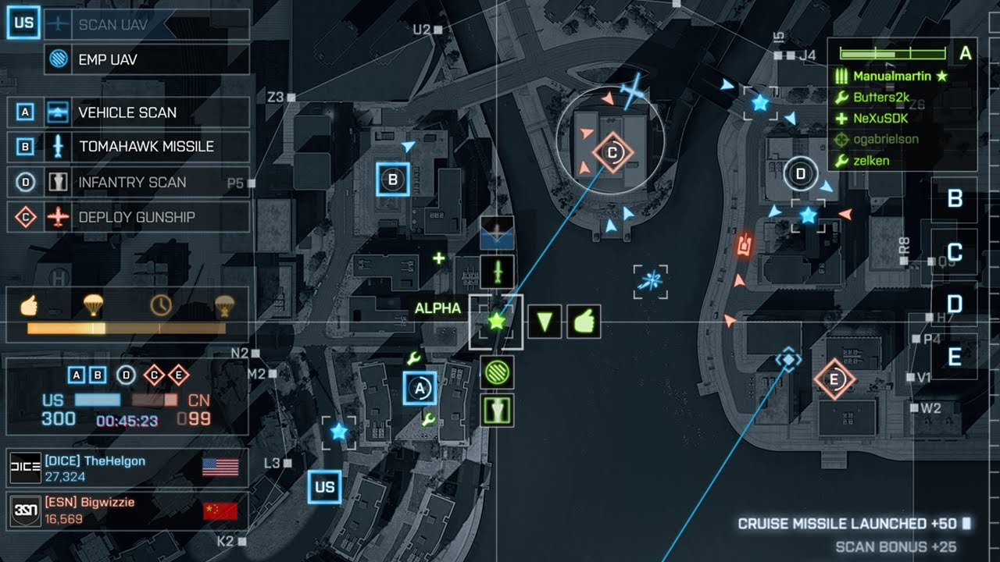
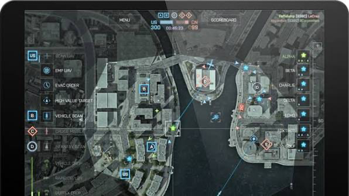
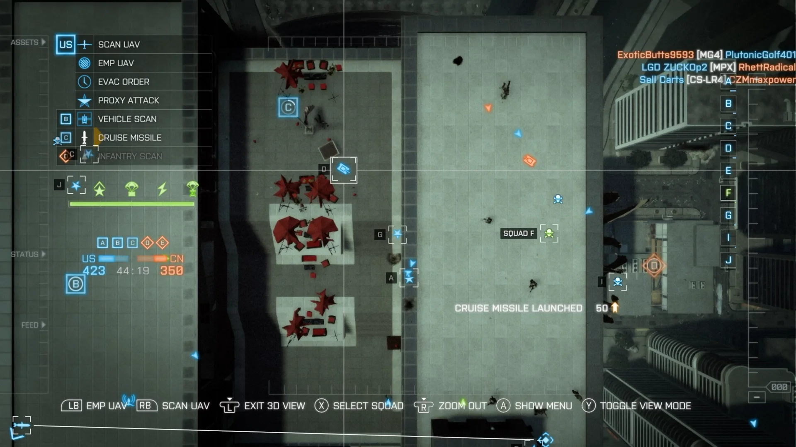
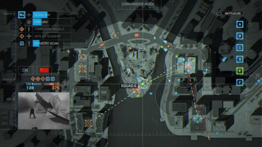

# Gridline: initial idea

Seed prompt for `/wayfinder`. Resend in a new session with:

```
/wayfinder @docs/idea/initial-prompt.md
```

## The idea (original prompt)

This came out after working a bit on my map-conflict website (in `personal-projects/map-conflict-project`).

I remembered a game mode I loved to play on my tablet in Battlefield 4, called Commander. Real players play a normal match, an FPS with guns, vehicles, capturing objectives and so on. Two other players take the role of commanders. Their only view is the map of the game, an aerial view. From there they can spawn UAVs, deploy vehicles, ammo crates, cruise missiles, soldier scans, vehicle scans, give orders to squads, promote squads, etc.

Reference images:

- 
- 
- 
- 

The game mode never returned in Battlefield titles after BF4. What if we built a dedicated browser game for it? Using three.js and other technologies to create a simulated battlefield where you take the commander role.

Let's discuss the project, the stack, the features, and how far it could stretch, i.e. how simulated the battles are. One thing I loved about this game mode: the commander sees players as little "doritos" on the map, but can click one and get a camera view of what is happening there (image 4, the small camera at the bottom left). How could we implement something like that? Could we use BattleBit-style graphics so it runs in a browser?

What else can we do to differentiate from BF4 Commander? More callouts?

## Session 1 progress (2026-11-03)

- Working title: **Gridline** (named after map grid references like Z3, P5). Repo: https://github.com/artsaraiva/gridline
- Charted: the wayfinder map is https://github.com/artsaraiva/gridline/issues/1. Resume with `/wayfinder https://github.com/artsaraiva/gridline/issues/1`; the questions below are answered there.

### Round 1 questions (historical; answered, see the map)

1. **Destination**: (a) vertical-slice spec (GDD + stack decisions, ready for `/to-spec`/`/implement`), (b) playable prototype, (c) full GDD. Recommended: (a).
2. **Who fights on the ground**: (a) simulated AI squads, player is only the commander, (b) real FPS players too, (c) AI now, human FPS later. Recommended: (a); the FPS layer is out of scope.
3. **Opponent**: (a) solo vs AI commander, (b) 1v1 human commanders online, (c) (a) now with a deterministic sim so (b) stays possible. Recommended: (c).
4. **Originality**: original factions, maps, asset names and look; inspired by the genre and mechanics only, no Battlefield/BattleBit names or art. Recommended: yes.
5. **Tracker**: GitHub Issues on `artsaraiva/gridline`. Settled.
6. **Time budget / ambition**: recommended a months-long hobby project, first target a playable slice (one map, one match vs AI).

Early take on the soldier cam: if the battlefield is a real low-poly 3D world, the commander map is an orthographic top-down camera and the soldier cam is a second perspective camera attached to a soldier, rendered into a corner viewport. This only works if the simulation lives in 3D, not a flat 2D map.
